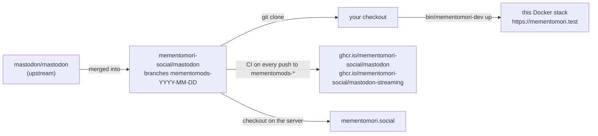
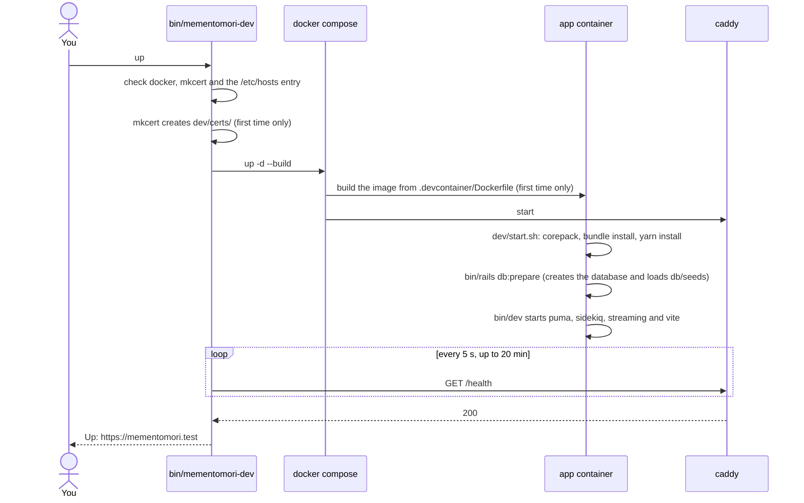
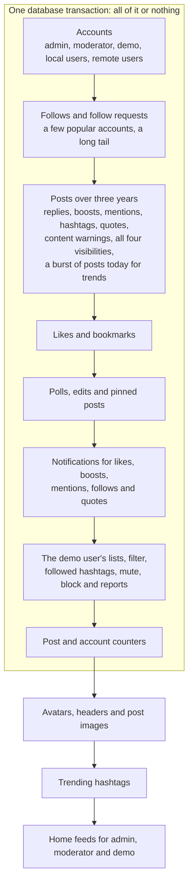

# mementomori.test in Docker

This runs your checkout of the fork at https://mementomori.test on macOS or Linux, with three years of generated demo data. It builds on the dev containers upstream Mastodon already ships in `.devcontainer/`. Everything Mementomori adds lives in files upstream doesn't have, so merging a new Mastodon release never conflicts with it.

- [Where the code lives](#where-the-code-lives)
- [How the stack fits together](#how-the-stack-fits-together)
- [Setup](#setup)
- [Daily use](#daily-use)
- [Demo data](#demo-data)
- [Running next to another local setup](#running-next-to-another-local-setup)
- [Differences from production](#differences-from-production)
- [Files](#files)
- [Troubleshooting](#troubleshooting)

## Where the code lives



- **mementomori-social/mastodon** is the only repository involved. The dev stack is three files and one rake task inside it, not a separate repo.
- **Branches**: production runs the newest `mementomods-YYYY-MM-DD` branch. Work on a branch made from it.
- **Container images**: CI publishes `latest` images for amd64 and arm64 on every push to a `mementomods-*` branch. They are production builds with compiled assets. This stack doesn't use them, because it runs your source code so edits show up immediately.

## How the stack fits together


| Path | Goes to | Notes |
| --- | --- | --- |
| `/api/v1/streaming*` | streaming, port 4000 | WebSocket timelines and notifications |
| `/packs-dev/*` | puma, which hands it to vite | JavaScript and CSS, compiled on request |
| everything else | puma, port 3000 | Rails |

Vite's hot-reload socket connects straight to `ws://mementomori.test:3036` (hard-coded in upstream's `vite.config.mts`), not through Caddy. Browsers refuse an unencrypted socket from an HTTPS page, so hot reload doesn't work here: after editing frontend code, reload the page yourself. Ruby changes need no restart; Rails reloads them on the next request.

**What persists**: the database, Redis, installed gems (`vendor/bundle`) and Caddy's state live in named Docker volumes of the `mementomori-dev` project. Node packages (`node_modules`) and uploaded media (`public/system`) live in your checkout, because the checkout is mounted into the container. `down` keeps all of it.

### What `up` does



The first start downloads images, builds the app image and installs every gem and Node package. Later starts reuse all of that and take about two minutes.

## Setup

The quickest way is one command, on macOS, Arch, Debian or Ubuntu:

```sh
git clone https://github.com/mementomori-social/ansibles.git && ansibles/dev.sh
```

It does everything below, clones this fork to `~/Projects/mastodon`, starts the stack and seeds it. It asks for your password once, and on macOS Docker Desktop's licence and the keychain need a click. See "Development environment" in the [ansibles README](https://github.com/mementomori-social/ansibles#development-environment).

By hand, you need Docker, mkcert and one line in `/etc/hosts`. Then clone the fork and switch to the branch you work on.

### macOS

1. Install Docker Desktop or OrbStack and start it.
2. `brew install mkcert` and `mkcert -install`. For Firefox also run `brew install nss` before `mkcert -install`.
3. `echo '127.0.0.1 mementomori.test' | sudo tee -a /etc/hosts`

On Apple Silicon the app image builds natively for arm64.

### Arch Linux

1. `sudo pacman -S docker docker-compose mkcert nss`, `sudo systemctl enable --now docker`, and add yourself to the `docker` group (`sudo usermod -aG docker $USER`, then log in again).
2. `mkcert -install`
3. `echo '127.0.0.1 mementomori.test' | sudo tee -a /etc/hosts`

### Debian and Ubuntu

1. Install Docker Engine with the compose plugin from Docker's own apt repository (docs.docker.com/engine/install), and add yourself to the `docker` group.
2. `sudo apt install mkcert libnss3-tools` and `mkcert -install`
3. `echo '127.0.0.1 mementomori.test' | sudo tee -a /etc/hosts`

### Every machine

```sh
git clone git@github.com:mementomori-social/mastodon.git
cd mastodon
git switch <the branch you work on>
bin/mementomori-dev up
bin/mementomori-dev seed
```

`up` stops with a message telling you what to fix if Docker, mkcert or the hosts entry is missing.

## Daily use

| Command | Does |
| --- | --- |
| `bin/mementomori-dev up` | Start everything and wait until the site answers |
| `bin/mementomori-dev up search` | The same plus Elasticsearch, with search turned on in the app |
| `bin/mementomori-dev up translate` | The same plus LibreTranslate for the Translate button. Combine both with `up search translate` |
| `bin/mementomori-dev seed [small\|default\|large]` | Fill an empty database with demo data, `default` if no scale is given |
| `bin/mementomori-dev reset [scale]` | Wipe this stack's database, uploads and Redis, then seed again. Asks first |
| `bin/mementomori-dev shell` | Bash inside the app container |
| `bin/mementomori-dev logs [service]` | Follow logs, for example `logs app` or `logs caddy` |
| `bin/mementomori-dev down` | Stop everything. Data stays |
| `bin/mementomori-dev compose <args>` | Any `docker compose` command for this stack, for example `compose ps` |

### Logins

Every generated account has the password `mementomori`.

| Email | Role | Use it for |
| --- | --- | --- |
| `demo@mementomori.test` | User | Home feed, notifications, lists, filters, bookmarks, followed hashtags |
| `admin@mementomori.test` | Owner | Admin settings, Sidekiq, everything |
| `moderator@mementomori.test` | Moderator | The moderation queue, with three open reports |

The other local accounts work too. Their email is `<username>@mementomori.test`, and Mastodon builds their home feed the first time you log in as one.

### Useful pages

| URL | What |
| --- | --- |
| https://mementomori.test/letter_opener | Every email the app has sent: sign-ups, password resets, notifications |
| https://mementomori.test/sidekiq | Background job queues, as admin |
| https://mementomori.test/admin/reports | Moderation queue |

### Rails console, tootctl and tests

```sh
bin/mementomori-dev shell
bin/rails console
bin/tootctl accounts modify demo --role Moderator

# Tests: name the test environment (the container defaults to development) and
# turn Elasticsearch off as upstream CI does, also after `up search`
ES_ENABLED=false RAILS_ENV=test bin/rails db:prepare     # once, creates the test database
ES_ENABLED=false RAILS_ENV=test bin/rspec spec/models/tag_spec.rb
```

### Search

```sh
bin/mementomori-dev up search
bin/mementomori-dev compose exec app bin/tootctl search deploy
```

Give Elasticsearch half a minute after `up` before `deploy`, which builds the indexes from what is in the database. Run it again after `reset`. Elasticsearch runs with its security turned off (`dev/compose.yaml`), because the 8.x image otherwise demands HTTPS and a password that Mastodon's dev config doesn't send.

## Demo data

`bin/mementomori-dev seed` runs `lib/tasks/mementomori_seed.rake`. It only runs in development and refuses to touch a database that already has the `demo` account.

Nothing in it is real. Names and texts come from Faker and fixed phrase lists, remote accounts live on `*.example` domains that never resolve, and images are generated colour gradients. That makes it safe to share, screenshot and commit.

### Same data on every machine

The generator draws every random choice from one fixed seed (`MementomoriSeed::SEED`). Two runs at the same scale give the same accounts, posts, likes and follows, so a bug one person sees reproduces for the next. The history ends at midnight UTC on the day you seed, so it moves with the calendar but never changes with the hour. The only posts from today are the trending burst, timed between midnight and the moment you run `seed`.

### Scales

| Scale | Local + remote accounts | Posts | Images | Time on a desktop |
| --- | --- | --- | --- | --- |
| `small` | 30 + 10 | 4 000 | 60 | about 2 minutes |
| `default` | 150 + 50 | 40 000 | 400 | about 5 minutes |
| `large` | 400 + 150 | 200 000 | 1 000 | not measured |

`small` is enough for most UI work. Use `default` when you need long timelines, busy notifications or realistic counts.

### What gets generated



Posts are written in bulk with ids in Mastodon's own time-ordered format, so timelines, pagination and "x days ago" behave as they would with real history. Activity grows over the three years and follows a daily rhythm, with most posts in the morning, at lunch and in the evening.

### Limits

- The home feed holds the newest 800 posts, the same cap as production. Older posts are on profiles, hashtags and the public timelines.
- Trending hashtags count people per day (UTC), so they fade the next day. `reset` brings them back.
- There are no link previews or trending links, since those need real web pages.
- Remote accounts can't be followed back or fetched: their servers don't exist.

## Running next to another local setup

If something on your machine already listens on 127.0.0.1:443, such as a hand-built mementomori.test behind nginx, give this stack another port and use it on every command:

```sh
HTTPS_PORT=8443 bin/mementomori-dev up
HTTPS_PORT=8443 bin/mementomori-dev seed
```

The site is then at https://mementomori.test:8443. To skip `HTTPS_PORT` on every command, write the port to `dev/https-port` (`echo 8443 > dev/https-port`); `bin/mementomori-dev` reads it when `HTTPS_PORT` is not set, and the Ansible setup writes it for you. The two setups share nothing: this one has its own containers, database and volumes, and stopping or resetting it leaves the other alone.

## Differences from production

| | This stack | Production |
| --- | --- | --- |
| Rails environment | development | production |
| PostgreSQL | 14, from upstream's dev compose | 18 |
| Frontend | vite dev server, compiled on request | precompiled assets |
| Media | `public/system` in your checkout | object storage |
| Email | caught at `/letter_opener` | sent |
| Federation | none, remote accounts are fake | live |
| Analytics script | not loaded | loaded |

## Files

| File | What |
| --- | --- |
| `bin/mementomori-dev` | The command you run |
| `dev/compose.yaml` | Layered over `.devcontainer/compose.yaml`: domain, HTTPS, start command, Caddy, Vite host check, optional services behind profiles |
| `dev/start.sh` | Runs inside the app container: installs gems and packages, prepares the database, starts `bin/dev` |
| `dev/Caddyfile` | TLS and routing |
| `dev/certs/` | Your mkcert certificate, created by `up`, not committed |
| `dev/https-port` | Optional HTTPS port when 443 is taken, not committed |
| `lib/tasks/mementomori_seed.rake` | The demo data generator |

## Troubleshooting

| Symptom | Fix |
| --- | --- |
| `up` fails to bind port 443 ("already allocated" or "address already in use") | Something else uses 443. Use `HTTPS_PORT=8443`, see above |
| Browser warns about the certificate | Run `mkcert -install` and restart the browser. Firefox on Linux and macOS also needs `nss` / `libnss3-tools` installed first |
| `mementomori.test` doesn't resolve | The `/etc/hosts` line is missing |
| `up` waits a long time | The first start installs everything. Watch it with `bin/mementomori-dev logs app` |
| `seed` says "Already seeded" | Use `reset`, which wipes and seeds in one go |
| "Oh, no! The requested page could not be rendered" on a page's first visit | Vite was bundling new dependencies and couldn't tell the page to reload (see hot reload above). Reload once; it stays fixed until `node_modules` changes |
| Page loads without styles or scripts | Check `logs app` for vite errors |
| Search finds nothing | Start with `up search` and run `bin/tootctl search deploy` |
| `search deploy` fails with `KeepAliveDisconnected` | Elasticsearch is still starting. Wait and run it again |
| You want to start completely from scratch | `bin/mementomori-dev compose down -v` removes every volume of this stack, including installed gems |
