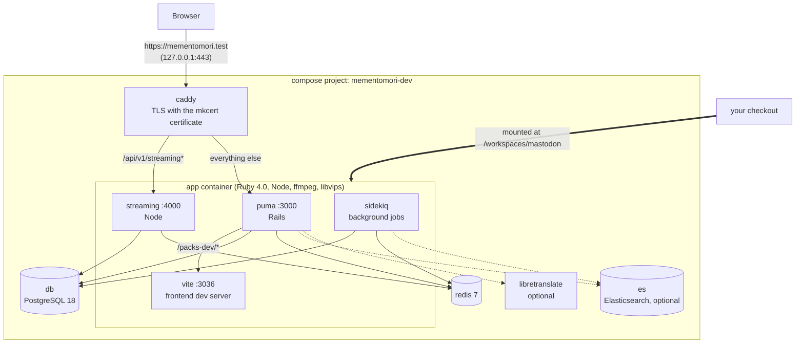
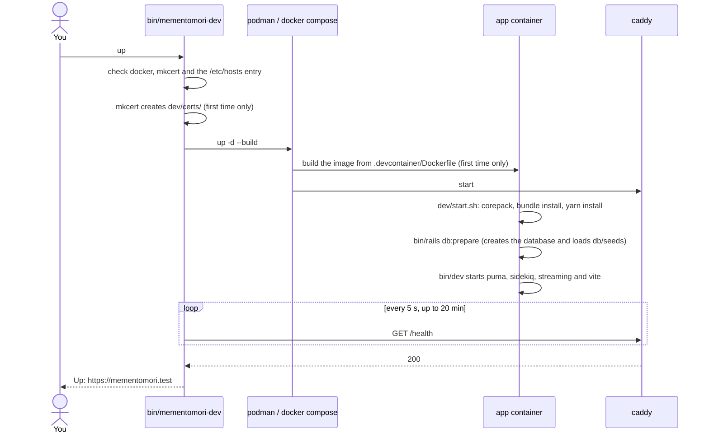
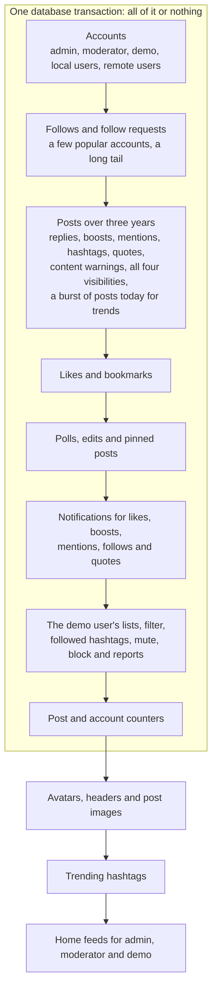

# mementomori.test in containers

This runs your checkout of the fork at https://mementomori.test on macOS or Linux, with three years of generated demo data. It builds on the dev containers upstream Mastodon already ships in `.devcontainer/`. Everything Mementomori adds lives in files upstream doesn't have, so merging a new Mastodon release never conflicts with it.

- [Where the code lives](#where-the-code-lives)
- [How the stack fits together](#how-the-stack-fits-together)
- [Setup](#setup)
- [Daily use](#daily-use)
- [Developing a feature](#developing-a-feature)
- [Demo data](#demo-data)
- [Production mode](#production-mode)
- [Running next to another local setup](#running-next-to-another-local-setup)
- [Differences from production](#differences-from-production)
- [Files](#files)
- [Troubleshooting](#troubleshooting)

## Where the code lives


- **mementomori-social/mastodon** is the only repository involved. The dev stack is three files and one rake task inside it, not a separate repo.
- **Branches**: production runs the newest `mementomods-YYYY-MM-DD` branch. Work on a branch made from it, see [Developing a feature](#developing-a-feature), which also covers pull requests to Mastodon itself.
- **Container images**: CI publishes `latest` images for amd64 and arm64 on every push to a `mementomods-*` branch. They are production builds with compiled assets. This stack doesn't use them, because it runs your source code so edits show up immediately.

## How the stack fits together



| Path | Goes to | Notes |
| --- | --- | --- |
| `/api/v1/streaming*` | streaming, port 4000 | WebSocket timelines and notifications |
| `/packs-dev/*` | puma, which hands it to vite | JavaScript and CSS, compiled on request |
| everything else | puma, port 3000 | Rails |

Vite's hot-reload socket connects straight to `ws://mementomori.test:3036` (hard-coded in upstream's `vite.config.mts`), not through Caddy. Browsers refuse an unencrypted socket from an HTTPS page, so hot reload doesn't work here: after editing frontend code, reload the page yourself. Ruby changes need no restart; Rails reloads them on the next request.

**What persists**: the database, Redis, installed gems (`vendor/bundle`) and Caddy's state live in named volumes of the `mementomori-dev` project. Node packages (`node_modules`) and uploaded media (`public/system`) live in your checkout, because the checkout is mounted into the container. `down` keeps all of it.

### What `up` does



The first start downloads images, builds the app image and installs every gem and Node package. Later starts reuse all of that and take about two minutes.

## Setup

The quickest way is one command, on macOS, Arch, Debian or Ubuntu:

```sh
git clone https://github.com/mementomori-social/ansibles.git && ansibles/dev.sh
```

It does everything below, clones this fork to `~/Projects/mastodon`, starts the stack and seeds it. It asks for your sudo password once, unless sudo needs none, and on macOS the keychain may ask you to confirm the certificate. See "Development environment" in the [ansibles README](https://github.com/mementomori-social/ansibles#development-environment).

By hand, you need Podman (or Docker), Docker Compose 2.24 or newer, mkcert and one line in `/etc/hosts`. Then clone the fork and switch to the branch you work on. `podman compose` runs the `docker-compose` program to read the compose files, so it is needed with Podman too.

### macOS

1. `brew install podman docker-compose`, then `podman machine init --rootful --cpus 4 --memory 8192` and `podman machine start`. Podman runs the containers in that Linux VM.
2. `brew install mkcert nss` and `mkcert -install`.
3. `echo '127.0.0.1 mementomori.test' | sudo tee -a /etc/hosts`

On Apple Silicon the app image builds natively for arm64. Docker Desktop or OrbStack work instead of Podman.

### Arch Linux

1. `sudo pacman -S podman docker-compose mkcert nss` and `systemctl --user enable --now podman.socket`
2. Let rootless Podman use port 443: `echo net.ipv4.ip_unprivileged_port_start=80 | sudo tee /etc/sysctl.d/90-mementomori-dev.conf` and `sudo sysctl --system`
3. `mkcert -install`
4. `echo '127.0.0.1 mementomori.test' | sudo tee -a /etc/hosts`

### Debian and Ubuntu

1. `sudo apt install podman mkcert libnss3-tools` plus `docker-compose-v2` on Ubuntu or `docker-compose` on Debian, then `systemctl --user enable --now podman.socket`
2. Let rootless Podman use port 443, as on Arch above.
3. `mkcert -install`
4. `echo '127.0.0.1 mementomori.test' | sudo tee -a /etc/hosts`

Rootless Podman runs the app as your own user (`dev/podman-rootless.yaml`), so files it writes into your checkout stay yours whatever your uid. With Docker on Linux the app container runs as uid 1000, so your own user should be uid 1000 too, which is the default for the first user on Arch, Debian, Ubuntu and Fedora.

### Podman or Docker

`bin/mementomori-dev` uses whichever of Podman and Docker is running, Podman first. To choose, set `DEV_ENGINE=docker` (or `podman`) on a command, or write the engine to `dev/engine` (`echo docker > dev/engine`); the Ansible setup writes it for you. The two engines keep separate images and volumes, so switching starts from an empty database: run `seed` again.

### Every machine

```sh
git clone git@github.com:mementomori-social/mastodon.git
cd mastodon
git switch <the branch you work on>
bin/mementomori-dev up
bin/mementomori-dev seed
```

`up` stops with a message telling you what to fix if Podman or Docker, mkcert or the hosts entry is missing.

## Daily use

| Command | Does |
| --- | --- |
| `bin/mementomori-dev up` | Start everything and wait until the site answers |
| `bin/mementomori-dev up live` | Run CI's production image of this branch instead of your checkout, see [Production mode](#production-mode). Plain `up` goes back |
| `bin/mementomori-dev up search` | The same plus Elasticsearch, with search turned on in the app |
| `bin/mementomori-dev up translate` | The same plus LibreTranslate for the Translate button. Combine both with `up search translate` |
| `bin/mementomori-dev seed [small\|default\|large]` | Fill an empty database with demo data, `default` if no scale is given |
| `bin/mementomori-dev reset [scale]` | Wipe this stack's database, uploads and Redis, then seed again. Asks first |
| `bin/mementomori-dev shell` | Bash inside the app container, or the web container in production mode |
| `bin/mementomori-dev check` | Check the running, seeded stack over HTTPS: certificate, streaming, demo's home, notifications, trending tags, posts and news, who to follow, moderator's reports. CI runs it too |
| `bin/mementomori-dev logs [service]` | Follow logs, for example `logs app` or `logs caddy` |
| `bin/mementomori-dev down` | Stop everything. Data stays |
| `bin/mementomori-dev compose <args>` | Any `podman compose` or `docker compose` command for this stack, for example `compose ps` |

### Logins

Every generated account has the password `mementomori`.

| Email | Role | Use it for |
| --- | --- | --- |
| `demo@mementomori.test` | User | Home feed, notifications, lists, filters, bookmarks, followed hashtags |
| `admin@mementomori.test` | Owner | Admin settings, Sidekiq, everything |
| `moderator@mementomori.test` | Moderator | The moderation queue, with three open reports |

The other local accounts work too. Their email is `<username>@mementomori.test`, and Mastodon builds their home feed the first time you log in as one.

### Useful pages

| URL | What |
| --- | --- |
| https://mementomori.test/letter_opener | Every email the app has sent: sign-ups, password resets, notifications |
| https://mementomori.test/sidekiq | Background job queues, as admin |
| https://mementomori.test/admin/reports | Moderation queue |

### Rails console, tootctl and tests

```sh
bin/mementomori-dev shell
bin/rails console
bin/tootctl accounts modify demo --role Moderator

# Tests: name the test environment (the container defaults to development) and
# turn Elasticsearch off as upstream CI does, also after `up search`
ES_ENABLED=false RAILS_ENV=test bin/rails db:prepare     # once, creates the test database
ES_ENABLED=false RAILS_ENV=test bin/rspec spec/models/tag_spec.rb
```

### Search

```sh
bin/mementomori-dev up search
bin/mementomori-dev compose exec app bin/tootctl search deploy
```

Give Elasticsearch half a minute after `up` before `deploy`, which builds the indexes from what is in the database. Run it again after `reset`. Elasticsearch runs with its security turned off (`dev/compose.yaml`), because the 8.x image otherwise demands HTTPS and a password that Mastodon's dev config doesn't send.

## Developing a feature

There are two kinds of feature work, and each has its own folder. Keep them apart: a pull request to Mastodon has to start from upstream `main`, not from a `mementomods-*` branch that carries our own changes.

| You want | Folder | Branch from | Runs at |
| --- | --- | --- | --- |
| A feature for mementomori.social | `~/Projects/mastodon` | the newest `mementomods-YYYY-MM-DD` | https://mementomori.test |
| A pull request to Mastodon itself | `~/Projects/mastodon-upstream` | `upstream/main` | http://localhost:3000 |

### A feature for mementomori.social

Everything happens in `~/Projects/mastodon`, the checkout `ansibles/dev.sh` made: you edit the code there, run git there and run `bin/mementomori-dev` there. The stack runs that folder's code directly, so an edit shows up on the next page load (reload the page for frontend changes).

1. Branch from the newest production branch:

   ```sh
   cd ~/Projects/mastodon
   git fetch origin
   git switch mementomods-2026-10-11   # the newest mementomods-* branch
   git pull
   git switch -c my-feature
   ```

2. Start the stack if it isn't running: `bin/mementomori-dev up`
3. Edit the code in `~/Projects/mastodon` and check it at https://mementomori.test.
4. Run the tests for what you changed:

   ```sh
   bin/mementomori-dev shell
   ES_ENABLED=false RAILS_ENV=test bin/rspec spec/models/tag_spec.rb
   ```

5. Commit and push: `git push -u origin my-feature`
6. When it's done, merge `my-feature` into the `mementomods-*` branch. Production picks it up on the next deploy from mementomori-social/ansibles.

### A pull request to Mastodon

Use a second clone of the fork, `~/Projects/mastodon-upstream`, with Mastodon itself added as the `upstream` remote. It runs Mastodon's own dev containers from `.devcontainer/`, not this stack, so there is no demo data and no mementomori.test.

1. Once:

   ```sh
   git clone git@github.com:mementomori-social/mastodon.git ~/Projects/mastodon-upstream
   cd ~/Projects/mastodon-upstream
   git remote add upstream https://github.com/mastodon/mastodon.git
   ```

2. For each feature, branch from the latest upstream `main`:

   ```sh
   cd ~/Projects/mastodon-upstream
   git fetch upstream
   git switch -c my-core-feature upstream/main
   ```

3. Stop this stack first, both use port 3036: `cd ~/Projects/mastodon && bin/mementomori-dev down`
4. Start Mastodon's dev containers, as Mastodon's `docs/DEVELOPMENT.md` describes (with Podman, write `podman compose` instead of `docker compose`):

   ```sh
   cd ~/Projects/mastodon-upstream
   docker compose -f .devcontainer/compose.yaml up -d
   docker compose -f .devcontainer/compose.yaml exec app bin/setup
   docker compose -f .devcontainer/compose.yaml exec app bin/dev
   ```

5. Edit the code in `~/Projects/mastodon-upstream` and check it at http://localhost:3000.
6. Push to the fork and open the pull request against Mastodon:

   ```sh
   git push -u origin my-core-feature
   gh pr create --repo mastodon/mastodon --base main --head mementomori-social:my-core-feature
   ```

7. Once Mastodon merges it, mementomori.social gets it when upstream is next merged into a new `mementomods-*` branch.

## Demo data

`bin/mementomori-dev seed` runs `lib/tasks/mementomori_seed.rake`. It only runs in development and refuses to touch a database that already has the `demo` account.

Nothing in it is real. Names and texts come from Faker and fixed phrase lists, remote accounts live on `*.example` domains that never resolve, and images are generated colour gradients. That makes it safe to share, screenshot and commit.

### Same data on every machine

The generator draws every random choice from one fixed seed (`MementomoriSeed::SEED`). Two runs at the same scale give the same accounts, posts, likes and follows, so a bug one person sees reproduces for the next. The history ends at midnight UTC on the day you seed, so it moves with the calendar but never changes with the hour. The only posts from today are the trending burst, timed between midnight and the moment you run `seed`.

### Scales

| Scale | Local + remote accounts | Posts | Images | Time on a desktop |
| --- | --- | --- | --- | --- |
| `small` | 30 + 10 | 4 000 | 60 | about 2 minutes |
| `default` | 150 + 50 | 40 000 | 400 | about 5 minutes |
| `large` | 400 + 150 | 200 000 | 1 000 | not measured |

`small` is enough for most UI work. Use `default` when you need long timelines, busy notifications or realistic counts.

### What gets generated



Posts are written in bulk with ids in Mastodon's own time-ordered format, so timelines, pagination and "x days ago" behave as they would with real history. Activity grows over the three years and follows a daily rhythm, with most posts in the morning, at lunch and in the evening.

### Limits

- The home feed holds the newest 800 posts, the same cap as production. Older posts are on profiles, hashtags and the public timelines.
- Trending hashtags count people per day (UTC), so they fade the next day. `reset` brings them back.
- Link previews exist only for the trending news articles, on `*.example` addresses that don't resolve. Other links in posts have none.
- Trending posts fade within about half a day and trending news within a day or two. `reset` brings them back.
- Remote accounts can't be followed back or fetched: their servers don't exist.

## Production mode

`bin/mementomori-dev up live` swaps the app container for the production image CI builds on every push to a `mementomods-*` branch (`ghcr.io/mementomori-social/mastodon` and `mastodon-streaming`): `RAILS_ENV=production`, precompiled assets, separate web, streaming and Sidekiq containers, as on the server. Use it to check something as it behaves live, for example asset loading, caching or a production-only code path.

It runs on the same database, Redis and media as dev mode, so seed in dev mode first:

```sh
bin/mementomori-dev up
bin/mementomori-dev seed small
bin/mementomori-dev up live
```

`bin/mementomori-dev up` goes back to dev mode. Both modes keep the same data.

- The image is tagged with your branch name when you are on a `mementomods-*` branch, otherwise `latest`, the newest build. Set `LIVE_TAG` to pick another. It is not your checkout: local edits don't show until they are pushed and built.
- Secrets that production mode needs (`SECRET_KEY_BASE`, VAPID keys) are generated on first use into `dev/live.env`, not committed. The Active Record encryption keys are the dev ones from `.env.development`, so both modes read the same data.
- `seed`, `reset` and `/letter_opener` only work in dev mode. Production mode writes mail to `tmp/mails` inside the web container instead of sending it.
- Production builds load the analytics script for mementomori.social. Caddy removes its host from the Content Security Policy, so the browser never runs it here, and the layout only loads it when `LOCAL_DOMAIN` is mementomori.social.

## Running next to another local setup

If something on your machine already listens on 127.0.0.1:443, such as a hand-built mementomori.test behind nginx, give this stack another port and use it on every command:

```sh
HTTPS_PORT=8443 bin/mementomori-dev up
HTTPS_PORT=8443 bin/mementomori-dev seed
```

The site is then at https://mementomori.test:8443. To skip `HTTPS_PORT` on every command, write the port to `dev/https-port` (`echo 8443 > dev/https-port`); `bin/mementomori-dev` reads it when `HTTPS_PORT` is not set, and the Ansible setup writes it for you.

To keep the plain https://mementomori.test address, let the other web server forward that name to this stack and tell the stack its public port with `echo 443 > dev/public-port` (or `PUBLIC_PORT=443`). The Ansible setup does both when the server on 443 is nginx: it adds a `mementomori.test` site to nginx that forwards to 8443, and moves any older `mementomori.test` site aside. The two setups share nothing: this one has its own containers, database and volumes, and stopping or resetting it leaves the other alone.

## Differences from production

| | Dev mode | Production mode (`up live`) | Production |
| --- | --- | --- | --- |
| Code | your checkout | CI's image of the branch | the branch, built on the server |
| Rails environment | development | production | production |
| PostgreSQL | 18 | 18 | 18 |
| Frontend | vite dev server, compiled on request | precompiled assets | precompiled assets |
| Processes | one container, `bin/dev` | web, streaming and Sidekiq containers | systemd services |
| Media | `public/system` in your checkout | same | object storage |
| Email | caught at `/letter_opener` | written to `tmp/mails` | sent |
| Federation | none, remote accounts are fake | none | live |
| Analytics script | not loaded | blocked | loaded |

## Files

| File | What |
| --- | --- |
| `bin/mementomori-dev` | The command you run |
| `dev/compose.yaml` | Layered over `.devcontainer/compose.yaml`: domain, HTTPS, start command, PostgreSQL 18, Caddy, Vite host check, optional services behind profiles |
| `dev/start.sh` | Runs inside the app container: installs gems and packages, prepares the database, starts `bin/dev` |
| `dev/Caddyfile` | TLS and routing |
| `dev/certs/` | Your mkcert certificate, created by `up`, not committed |
| `dev/podman-rootless.yaml` | Added for rootless Podman: runs the app as your own user |
| `dev/engine` | Optional `podman` or `docker`, not committed |
| `dev/https-port` | Optional HTTPS port when 443 is taken, not committed |
| `dev/public-port` | Optional port in the site's address when another server forwards to this stack, not committed |
| `dev/check.sh` | The checks behind `bin/mementomori-dev check` |
| `.github/workflows/dev-stack.yml` | CI: builds the stack on a clean Ubuntu machine, seeds it and runs `check` in both modes |
| `dev/live.yaml` | Production mode services, layered last |
| `dev/live.env` | Production mode secrets, created by `up live`, not committed |
| `dev/mode` | `dev` or `live`, written by `up`, not committed |
| `lib/tasks/mementomori_seed.rake` | The demo data generator |

## Troubleshooting

| Symptom | Fix |
| --- | --- |
| `up` fails to bind port 443 ("already allocated" or "address already in use") | Something else uses 443. Use `HTTPS_PORT=8443`, see above |
| Browser warns about the certificate | Run `mkcert -install` and restart the browser. Firefox on Linux and macOS also needs `nss` / `libnss3-tools` installed first |
| `mementomori.test` doesn't resolve | The `/etc/hosts` line is missing |
| `up` waits a long time | The first start installs everything. Watch it with `bin/mementomori-dev logs app` |
| `seed` says "Already seeded" | Use `reset`, which wipes and seeds in one go |
| Demo data gone after updating this branch | The database moved from PostgreSQL 14 to 18 on a new volume. Run `seed` again. The old data stays in the `postgres-data` volume until you remove it with `docker volume rm mementomori-dev_postgres-data` |
| `seed` or `reset` says "This needs dev mode" | You are in production mode. `bin/mementomori-dev up` first |
| "Oh, no! The requested page could not be rendered" on a page's first visit | Vite was bundling new dependencies and couldn't tell the page to reload (see hot reload above). Reload once; it stays fixed until `node_modules` changes |
| Page loads without styles or scripts | Check `logs app` for vite errors |
| Search finds nothing | Start with `up search` and run `bin/tootctl search deploy` |
| `search deploy` fails with `KeepAliveDisconnected` | Elasticsearch is still starting. Wait and run it again |
| You want to start completely from scratch | `bin/mementomori-dev compose down -v` removes every volume of this stack, including installed gems |
